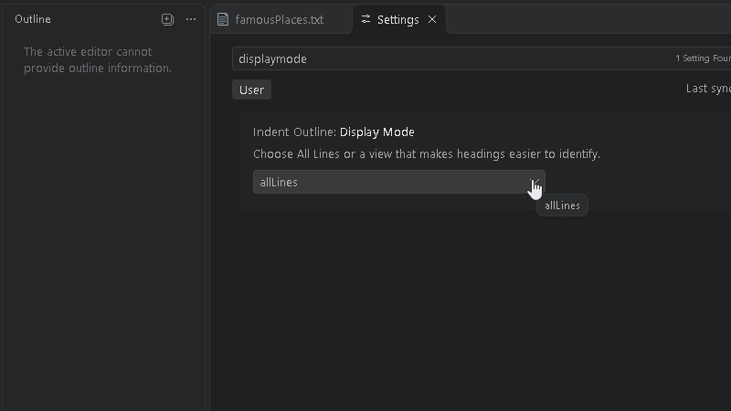
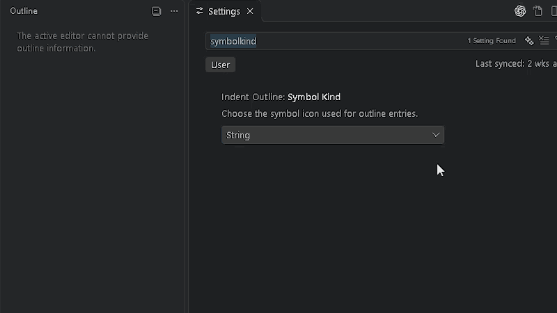
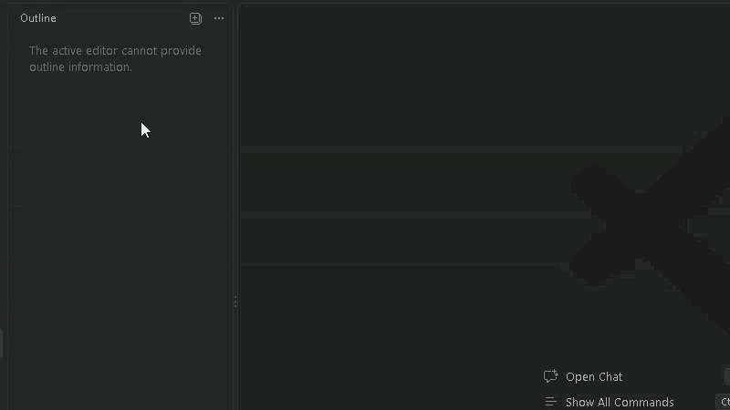

# Plain Text Outline Navigator

[English version](README.md)

プレーンテキストをアウトラインビューに「インデントに基づく階層」で表示する拡張機能です。
- `plaintext` のドキュメントをアウトラインビューで階層表示します。
- インデントを解析して見出しを捉えやすい表示にもできます。
- 行頭のアイコンを変更できます。
- 元のファイルは変更しません。

## 開発動機

私はVSCodeを日常のメモ、アイデア、備忘録など、
開発だけでなく普段のテキストエディタとしても利用しています。
テキストの見出しや構成はインデント(タブ)によって決めています。

VSCodeでは、テキストのインデントはアウトラインとして解釈されません。
* 全体を把握したい
* 目的の見出しがあるか確認したい
* 見出しにすぐに飛びたい
* 構成単位で並べ替えたい
  
といったとき、
アウトラインビューに見出し(シンボル)が表示されないので、
全体を掴みたいときに行数が多いと苦労します。

近年はMarkdownで書くことも多く、Markdownは１つの解決策ですが、
過去のファイルがたくさんあり、可能なら、
「ファイルを変更することなくアウトラインビューを表示したい」
と思い開発しました。

## 機能

- プレーンテキストのインデントから階層を作成します。
- タブとスペースに対応し、エディターの `tabSize` 設定を使ってインデントを解釈します。
- 「全行表示」と「見出し表示」を切り替えられます。
- 行頭のアイコンを複数用意しており、見やすいものに変更できます。
- 元のテキストを変更しません。
  
## 2つの表示モード

用途に合わせて表示を切り替えられます。

### 表示モードの切り替え

**全行表示**と**見出し表示**を切り替え、用途に応じたアウトライン表示にできます。



- **全行表示**（`indentOutline.displayMode: allLines`、既定値）: 
テキスト全体を、開閉可能なコンパクトビューとしてアウトラインビューに表示します。
- **見出し表示**（`indentOutline.displayMode: headingFocused`）: 
内容と思われるインデント行を隠して見出しを捉えやすくします(ルート行は常に表示)。

どちらのモードでも空行はアウトラインビューに表示されません。

## アイコンの変更

アウトラインビューで表示するアイコンを変更できます。

### アイコンの設定

設定からアイコンの種類を選び、アウトラインビューの見た目を変更できます。




## 使い方

1. 言語モードが `plaintext` のドキュメントを開きます。
2. 行頭にインデントを付けて、行を階層化します。
3. エクスプローラーの **アウトライン** を開き、階層の確認や移動(ジャンプ)ができます。
4. `indentOutline.displayMode` で表示モードを選びます。

### 基本動作

インデント付きのプレーンテキストを開き、アウトラインビューで階層を確認・移動する基本的な流れです。



例:

```text
プロジェクト
    計画
        要件
            プランターが十分おける広さ、水はけが良い
        スケジュール
            1日目は掃除
            2日目は組み立て
    作業
        準備
        機能
```

### 全行表示

`indentOutline.displayMode` を `allLines` にした場合:

```text
プロジェクト
    計画
        要件
            プランターが十分おける広さ、水はけが良い
        スケジュール
            1日目は掃除
            2日目は組み立て
    作業
        準備
        機能
```

### 見出し表示

`indentOutline.displayMode` を `headingFocused` にした場合:

```text
プロジェクト
    計画
        要件
        スケジュール
    作業
```

## 拡張機能の設定

| 設定                        | 既定値     | 説明                                                                                                                                                                                             |
| --------------------------- | ---------- | ------------------------------------------------------------------------------------------------------------------------------------------------------------------------------------------------ |
| `indentOutline.displayMode` | `allLines` | `allLines` はテキスト全体を、開閉可能なコンパクトビューとしてアウトラインビューに表示します。`headingFocused` は内容と思われるインデント行を隠して見出しを捉えやすくします(ルート行は常に表示)。 |
| `indentOutline.symbolKind`  | `String`   | アウトラインビューで表示するアイコンを選択します。`String`、`Constant`、`Method`、`Number`、`Array`、`TypeParameter` から選べます。                                                              |

インデントは、ドキュメントに対するエディターの `editor.tabSize` 設定に基づいて判定されます。`editor.tabSize` が `auto` の場合は 4 として扱います。

## 対応するドキュメント

言語モードが `plaintext` のドキュメントをアウトラインビューに表示します。
