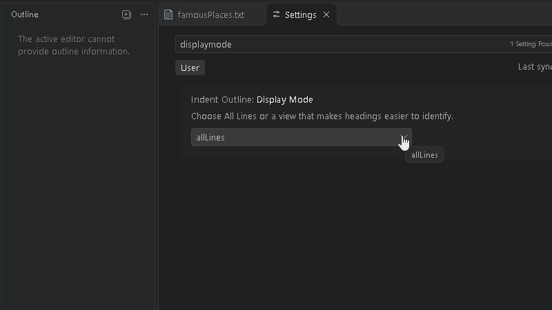
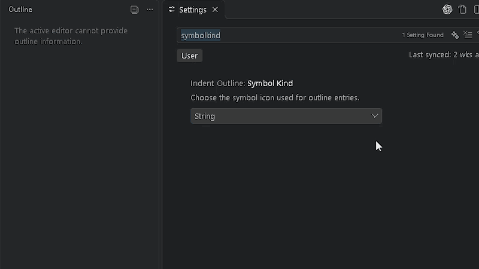
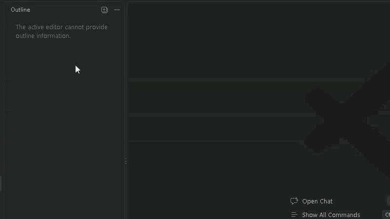

# Plain Text Outline Navigator

[Japanese version](README.ja.md)

This extension displays plain-text documents in the VS Code Outline view as an indentation-based hierarchy.

- Display `plaintext` documents as a hierarchy in the Outline view.
- Analyze indentation to make headings easier to identify.
- Change the icons shown at the start of outline entries.
- Leave the original files unchanged.

## Motivation

I use VS Code every day for notes, ideas, and reminders—not only for development, but also as a general-purpose text editor. I organize headings and structure in my text using indentation (tabs).

VS Code does not interpret indentation in plain-text documents as an outline. When I want to understand the overall structure, check whether a heading exists, jump directly to a heading, or rearrange a section, it can be difficult to navigate long documents because headings (symbols) are not shown in the Outline view.

Markdown is one solution, and I often write in Markdown. However, I have many existing files, and I wanted to show them in the Outline view without changing the files.

## Features

- Build a hierarchy from indentation in plain-text documents.
- Support tabs and spaces, interpreting indentation with the editor's `tabSize` setting.
- Switch between All Lines View and Heading View.
- Choose from several icons to find an outline style that is easy to read.
- Leave the original text unchanged.

## Two display modes

Choose a display mode to suit your needs.

### Switching display modes

Switch between All Lines View and Heading View to display the outline in a way that suits your needs.



- **All Lines View** (`indentOutline.displayMode: allLines`, the default): Displays the entire text as a compact, collapsible view in the Outline view.
- **Heading View** (`indentOutline.displayMode: headingFocused`): Hides indented lines that are likely to be content, making headings easier to identify. Root lines are always shown.

Blank lines are omitted from the Outline view in both modes.

## Changing icons

You can change the icons displayed in the Outline view.

### Icon settings

Choose an icon kind in the extension settings to change the appearance of the Outline view.



## Usage

1. Open a document using the `plaintext` language mode.
2. Indent lines to organize them into levels.
3. Open **Outline** in the Explorer view to browse the hierarchy and navigate to lines.
4. Choose a display mode with `indentOutline.displayMode`.

### Basic operation

Open an indented plain-text document, then browse and navigate its hierarchy in the Outline view.



Example:

```text
Project
    Planning
        Requirements
            Enough space for the planters and good drainage
        Schedule
            Day 1: Cleaning
            Day 2: Assembly
    Work
        Preparation
        Features
```

### All Lines View

With `indentOutline.displayMode` set to `allLines`:

```text
Project
    Planning
        Requirements
            Enough space for the planters and good drainage
        Schedule
            Day 1: Cleaning
            Day 2: Assembly
    Work
        Preparation
        Features
```

### Heading View

With `indentOutline.displayMode` set to `headingFocused`:

```text
Project
    Planning
        Requirements
        Schedule
    Work
```

## Extension settings

| Setting | Default | Description |
| --- | --- | --- |
| `indentOutline.displayMode` | `allLines` | `allLines` displays all text as a compact, collapsible view in the Outline view. `headingFocused` hides indented lines that are likely to be content, making headings easier to identify. Root lines are always shown. |
| `indentOutline.symbolKind` | `String` | Choose the icon displayed in the Outline view. Options: `String`, `Constant`, `Method`, `Number`, `Array`, and `TypeParameter`. |

Indentation is determined using the editor's `editor.tabSize` setting for the document. If `editor.tabSize` is set to `auto`, it is treated as 4.

## Supported documents

The extension displays documents using the `plaintext` language mode in the Outline view.
